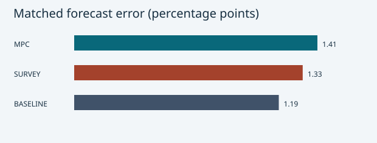

# Why Do Forecasters Disagree?

How different are official projections and the surveyed median for the same inflation target? The archive matches five same-date, same-quarter estimates from the RBI Monetary Policy Committee and the RBI survey of external professional forecasters.

Mean absolute errors against the published monthly CPI average were 1.411 percentage points for the MPC, 1.325 for the survey median, and 1.187 for a last-release persistence baseline. Four rows forecast the same Q3 outcome. These scores are descriptive and give no strong evidence of lasting differences in forecasting skill.

## Two cases

- **August 2025, Q3.** MPC projected 3.1%, versus 2.7% in the survey. The MPC linked near-term moderation to lower food inflation, a favorable base and monsoon conditions, while warning about a later reversal in base effects. The survey published the median and distribution. Individual contributors' assumptions are unavailable, so the measured gap cannot be attributed to a specific difference in their models.
- **October 2025, Q3.** MPC projected 1.8%, versus 2.0% in the survey. Both had revised down from August. The MPC attributed its softer outlook to GST rate cuts and benign food prices, even while warning later base effects would put upward pressure on inflation. The survey documents the shift in estimates and leaves the exact reason for the 0.2-point remaining gap unresolved.

Use Python 3.11 or later. Run `python -m unittest -v` and `python archive.py`, then open `index.html` and filter for “FY26 Q2”. The command recreates the CSV, chart, and archive. No dependencies or keys are required.

The source register in `data.json` gives the decision, survey and MoSPI release links and publication dates. To reproduce, read each RBI release's quarterly CPI projection and the corresponding survey's Table 3, then match by publication and fiscal quarter. MoSPI month-by-month figures come from the first release, on the pre-2026 base. This project compares fixed-quarter forecasts at several lead times. Explain the cost of counting the Q3 outcome four times and why the December nowcast had an informational advantage.

Neil Meher specified the forecast comparison. Codex compiled the public data, selected the overlap, and executed the analysis. Neil's independent source review is pending.
